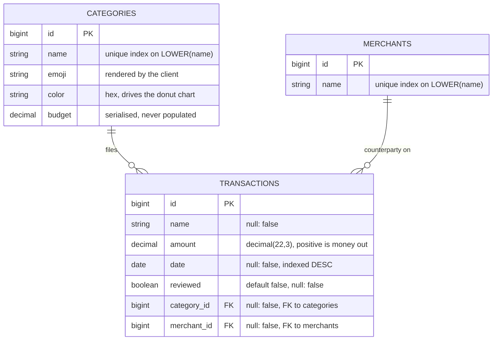
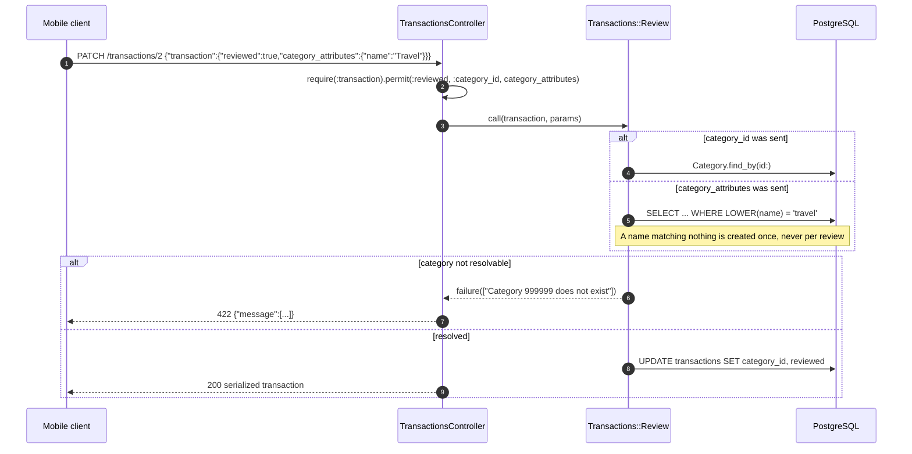

# Peach transactions API

A Rails 6.1 JSON API over a personal-finance ledger. It imports a ten-row fixture
CSV of bank transactions, serves each one with its merchant and category embedded,
and accepts exactly one write: marking a transaction reviewed, optionally
correcting the category it was imported under.

The fixture arrives deliberately miscategorised — all ten rows filed as "Shops",
payroll deposit and tax payment included — and correcting them is the product. The
client is [`peach-assessment-frontend`](../peach-assessment-frontend), a React
Native / Expo app. There is no web UI here and none is intended, so the evidence is
captured request/response pairs: [`docs/api-transcript.md`](docs/api-transcript.md).

## What the ledger looks like

Three tables. Transactions are imported facts; categories and merchants are
reference data the client renders and the user picks from.



Three details there are load-bearing. **`amount` is `decimal(22,3)`**, and Active
Record serialises decimals as JSON strings (`"129.97"`), so nothing rounds through an
IEEE-754 double on the way out — the client parses it in `src/domain/money.js`. **The
unique indexes are on `LOWER(name)`**, which is what makes the case-insensitive
category matching in `Transactions::Review` hold in the database rather than only in
Ruby, and `index_transactions_on_reviewed_and_date` serves the only list query this
API has. **`dependent: :restrict_with_error`** on both reference models means
deleting a category cannot take the accounting rows filed under it with it.

## The six endpoints

| Method  | Path                 | Returns |
| ------- | -------------------- | ------- |
| `GET`   | `/health`            | `{"status":"ok","database":"ok"}` — runs `SELECT 1`, so a booted process that cannot reach Postgres reports 503 |
| `GET`   | `/categories`        | reference data, name-ordered |
| `GET`   | `/merchants`         | reference data, name-ordered |
| `GET`   | `/transactions`      | bare JSON array, newest first, paginated via headers |
| `GET`   | `/transactions/:id`  | one transaction with merchant and category embedded |
| `PATCH` | `/transactions/:id`  | the review write |

`GET /transactions` returns a **bare array**, not `{"data": [...]}`: the client
pipes the response straight into `normalizeTransactions`, which returns `[]` for
anything that is not an array, so an envelope would silently blank the screen.
Pagination therefore travels in headers — `X-Total-Count`, `X-Page`, `X-Per-Page`,
`X-Total-Pages` — which `config/initializers/cors.rb` exposes to browsers.
`ApplicationController` inherits `ActionController::API` and `config.api_only` is
true, so no cookie, session, flash or CSRF middleware sits on any of these paths.

```console
$ curl -s -i 'http://127.0.0.1:8820/transactions?pending_review=true&per_page=2'
HTTP/1.1 200 OK
X-Total-Count: 10
X-Page: 1
X-Per-Page: 2
X-Total-Pages: 5
Content-Type: application/json; charset=utf-8

[{"id":2,"name":"SFO to JFK","date":"2023-05-29","amount":"129.97","reviewed":false,"merchant":{"id":2,"name":"United"},"category":{"id":4,"name":"Shops","emoji":"🛍","color":"#B6E4FB","budget":null}},{"id":1,"name":"Uber","date":"2023-05-29","amount":"45.12","reviewed":false,"merchant":{"id":1,"name":"Uber"},"category":{"id":4,"name":"Shops","emoji":"🛍","color":"#B6E4FB","budget":null}}]
```

## What happens when someone reviews a transaction

`TransactionsController` is 58 lines of HTTP translation: reads go to
`app/queries/transactions_query.rb`, the write to `app/services/transactions/review.rb`,
failures to `app/controllers/concerns/exception_handler.rb`, wire shapes to
`app/serializers/`.



A service object rather than `accepts_nested_attributes_for`, because of the trap
in that second branch: on a `belongs_to` with no `id` in the nested hash, Active
Record's nested-attribute writer falls through to `build_category`. Every
recategorisation would then mint a **new** category row holding only a name and an
emoji — reference data growing a duplicate per review, each with `color: nil`,
which is exactly the grey placeholder the client's chart falls back to. Resolving
instead of building is pinned by name in
`spec/services/transactions/review_spec.rb` ("resolves an existing category instead
of creating a duplicate", "stays idempotent when the client sends the same review
twice") and end to end at `spec/requests/transactions_spec.rb:152`.
`category_id` is the cleaner input and is supported, but `category_attributes` is
the shape the shipped client sends, so it stays a first-class path.

## Filters are cast, not guessed

Every query-string value arrives as a `String`, so `"false"` and `"0"` are both
truthy in Ruby. `TransactionsQuery` casts explicitly and **more strictly than
`ActiveModel::Type::Boolean`**, which maps every unrecognised string — "maybe", a
typo — to `true`: `?reviewed=maybe` is a 400, not a quietly different answer. So
is `?reviewed=true&pending_review=true`, which asks for two disjoint sets rather
than a guess at which was meant. `pending_review` exists as a first-class inverse
alias of `reviewed` because it is the spelling the client already ships.

The relation is bounded (100 rows by default, 200 maximum), ordered by
`date DESC, id DESC`, and preloads both embedded associations. Postgres promises no
ordering without an `ORDER BY`, so paging an unordered relation can repeat one row
and skip another — ordering and paging therefore live in the same object. Adding a
filter is one `register(:name) { |scope, value| ... }` call, which is the extension
seam a future filter actually needs.

## One error shape

Every failure renders `{"message": [...]}`, and `message` is **always** an array —
validation produces a list, and a client that special-cases "sometimes a string,
sometimes an array" is a client waiting to crash. Four exceptions are mapped:

| Raised                                  | Status | Example body |
| --------------------------------------- | ------ | ------------ |
| `ActiveRecord::RecordNotFound`          | 404    | `{"message":["Transaction not found"]}` |
| `ActionController::ParameterMissing`    | 400    | `{"message":["Missing required parameter: transaction"]}` |
| `TransactionsQuery::InvalidFilter`      | 400    | `{"message":["reviewed must be true or false"]}` |
| `ActiveRecord::RecordInvalid`           | 422    | the model's `full_messages` |

A JSON body without a `transaction` key is *not* a 400 — `wrap_parameters` wraps a
bare JSON object into `params[:transaction]`. That 400 is a form-encoded request.

## Run it

Ruby 3.1.x (`.ruby-version` pins 3.1.3) and PostgreSQL 13+.

```bash
bin/setup                      # bundle, prepare the database, seed the fixture ledger
bin/rails s                    # http://localhost:3000
curl -s localhost:3000/health  # {"status":"ok","database":"ok"}
```

Seeding is idempotent — `lib/seeds.rb` upserts on name + date + merchant, so
re-running it neither duplicates the ledger nor discards a review already made, and
`spec/seeds_spec.rb` checks the result against figures computed independently from
the CSV in [`docs/seeded-figures.md`](docs/seeded-figures.md).

A multi-stage `Dockerfile` (`ruby:3.1.3-slim`, non-root `peach` user,
`zeitwerk:check` inside the build, `HEALTHCHECK` on `/health`) and a
`docker-compose.yml` (postgres:16-alpine behind a `pg_isready` gate) are committed:

```bash
export SECRET_KEY_BASE=$(bin/rails secret)
docker compose up --build      # API on http://localhost:8820
```

**Be sceptical of that one.** `docker compose config -q` exits 0, so the compose file
parses, but the image has never been built or booted here. This repo's uplift report
records `Build verified: NOT RUN — deferred, Docker off` and
`Boot verified: NOT RUN — deferred, Docker off`, so treat the container path as
unproven.

### Environment

Nothing is required locally: every variable has a working default, and with no
dotenv gem in the bundle you export them yourself or let `docker-compose.yml` supply
them. `config/database.yml` is fully environment-driven and no credential is
committed anywhere; [`.env.example`](.env.example) lists everything with comments.
Four worth calling out:

- `DATABASE_URL` is merged over `database.yml`, so it is the only variable a
  container needs. The `DATABASE_HOST` / `PORT` / `USER` / `PASSWORD` / `NAME`
  pieces work too, and `TEST_DATABASE_NAME` names the database the suite truncates.
- `RAILS_MAX_THREADS` (default `5`) sets Puma's threads **and** the Active Record
  pool size. Keep them equal.
- `ALLOWED_ORIGINS` is an empty comma-separated allowlist, so CORS is off by
  default rather than `*` — a native client sends no `Origin` at all.
- `SECRET_KEY_BASE` is **required in production** with no default
  (`bin/rails secret`). There is no encrypted credentials file in this repository.

## Tests, lint and the query benchmark

```console
$ bundle exec rspec
93 examples, 0 failures

$ bundle exec rubocop
54 files inspected, no offenses detected
```

The suite talks to a real PostgreSQL database rather than a mocked repository,
because a mock cannot catch a missing index, a wrong `ORDER BY`, or a
nested-attribute writer aimed at the wrong table. `spec/requests/` pins the wire
contract the client reads — JSON shapes, status codes, pagination headers, query
counts — and `spec/queries/`, `spec/services/transactions/`, `spec/models/` and
`spec/seeds_spec.rb` cover the rest at unit level. Full run, including proof the
suite can fail: [`docs/test-run.md`](docs/test-run.md).

`scripts/bench_queries.rb` serialises the same list preloaded and unpreloaded
against a live seeded database and counts SQL:

```console
$ bin/rails runner scripts/bench_queries.rb
rows in table:        10
queries, old code:    21
queries, new code:    3
```

`21` is `1 + 2N` for a bare `Transaction.all` — the list, then a category and a
merchant per row. `3` is the list plus one preload per association; the endpoint
issues a fourth for `X-Total-Count`.

## Out of scope

- **No authentication and no authorization.** There is no `User` table, so every
  caller can read and modify every transaction — inherent to the exercise as
  specified. `spec/requests/transactions_spec.rb` pins it under "access control
  (documented, not enforced)" so it cannot be mistaken for something enforced
  elsewhere. Do not expose this to the internet.
- **The write set is deliberately narrow** — no create, no delete, no editing of a
  transaction's name, amount or date. Ledger lines are facts; only flags are data.
- **No aggregate endpoint.** The client computes spend-by-category itself, which is
  right at ten rows. Past a few thousand it would want a `GET /transactions/summary`.
- **`Category#budget` is unused** — the column is serialised but nothing in the app
  writes it, so it is `null` for every seeded category.
- **No queue, cache or second process.** A ten-row ledger with two reference
  tables has no throughput problem; the measurable cost was N+1 queries.
